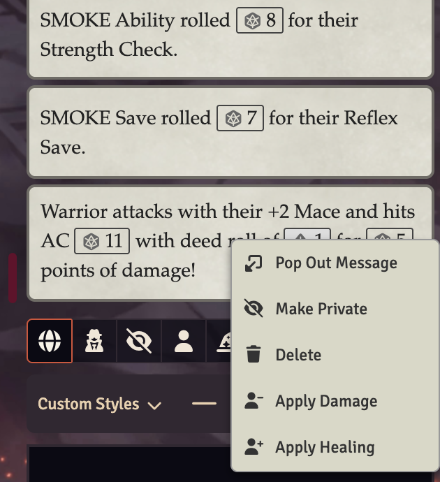
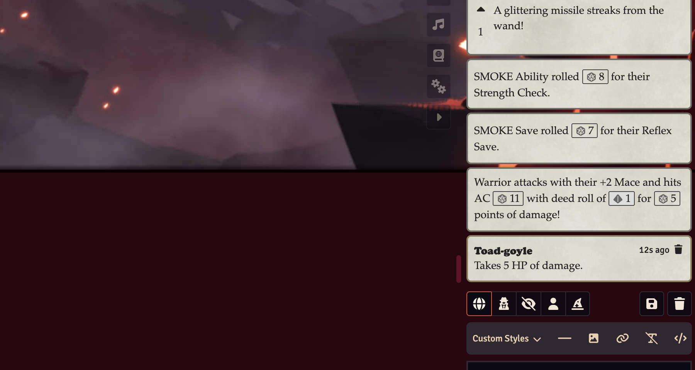

# Applying Damage

You can right-click to deal damage or apply healing to a selected token.

The Warrior in this situation is attacking the Toad-Goyle. They hit for 5 damage. I have selected the Toad-Goyle and right-clicked on the attack chat message - you can see the "Apply Damage" option.

After choosing this option, the 5 damage was applied to the Toad-Goyle token's HP, and you can see a message confirming that in the chat.

You can do the same thing with a healing roll, but choose Apply Healing. For Lay on Hands, the result card can also heal the target for you: see [Cleric](Cleric.md#healing-with-lay-on-hands).

## Adjusting the Amount at Apply Time

Sometimes the number on the card isn't the number you want to apply — for example, a player decides to spend Luck only after seeing the rolled damage.

Hold Ctrl (Cmd on Mac) while clicking Apply Damage or Apply Healing to open a small dialog instead of applying immediately. (If you have the "Show Roll Modifier by Default" setting enabled, this is reversed: the dialog opens on a plain click, and Ctrl/Cmd-click applies directly.) The dialog is pre-filled with the amount from the card; edit it and press Apply to apply the adjusted amount to the selected tokens.

If the roll came from an actor, the dialog also offers a "Spend Luck" field. Entering an amount there deducts that much Luck from the roller and records the spend in their Ability Score Change Log (when that setting is enabled). The Luck spend does not change the damage number automatically — how Luck modifies a roll is your table's ruling, so adjust the amount field yourself.

When the damage is subdual damage, the dialog's **Subdual Damage** box is already ticked. Untick it to apply the damage to hit points instead, or tick it to treat any damage as subdual.

## Subdual Damage

A weapon with **Subdual Damage** ticked on its item sheet deals subdual damage: you use the flat of the blade to capture an opponent alive. Per the rules, an opponent brought to 0 hit points by subdual damage collapses unconscious instead of dying.

With the **Track Subdual Damage** setting on (the default), subdual damage doesn't come off hit points. It adds to a separate subdual total, shown as a small fist badge on the HP shield of the character or NPC sheet. When the total reaches the creature's current hit points, the chat message says it collapses unconscious. Nothing else changes automatically: you decide when it comes round.

To change or clear the total, open **Adjust Hit Points** from the sheet's window menu (or the party sheet) and edit the **Subdual Damage** field.

With the setting off, subdual damage reduces hit points like any other damage.

## Natural Healing

Open **Adjust Hit Points** from the sheet's window menu (or click a member's HP on the party sheet). Under **Natural Healing**, enter the number of nights or days and click:

- **Night's Rest**: 1 hit point per night of rest while adventuring.
- **Bed Rest**: 2 hit points per day of complete bed rest.

Healing never raises hit points above the maximum. Ability score damage also heals with rest; record that recovery in the Ability Score Change Log.
