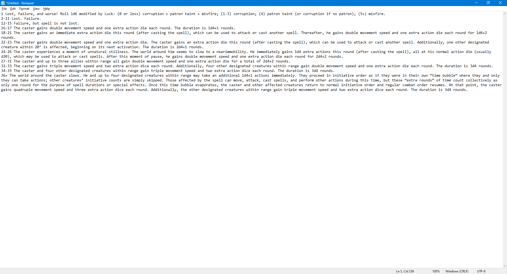
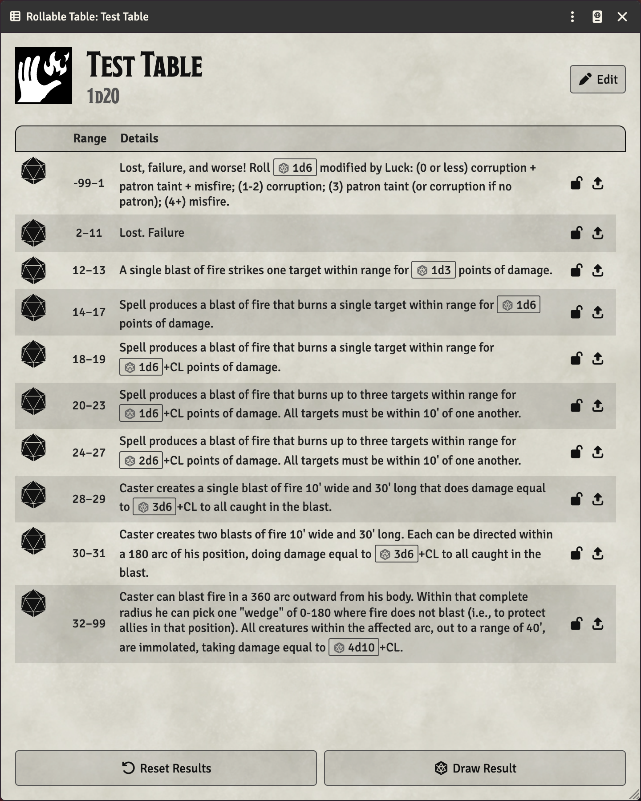

You can use the **[Roll Table Importer](https://foundryvtt.com/packages/roll-table-importer)** module to import a table straight from a PDF. First make sure the module is installed and enabled. The **Table Importer** setting should be enabled by default under **Module Settings**.

Next, go to the **Rollable Tables** tab in the upper right of the Foundry interface and click **Import Tables** at the top of the sidebar.



Copy/paste your table from the PDF into Notepad (or Notes on the Mac). Make sure each line is a number, followed by an entry. If the entry is very long it can word wrap, but **make sure it is all part of the same line**. If it isn't, the table won't come out right. You may also want to do a find and replace on "- " to remove the hyphenations.



### Common problems

The importer is strict about a few things that DCC tables copied from a PDF often get wrong:

- **Start with a title line that has no commas.** The first line always becomes the table name, so a table starting with a result loses that result. If the first line contains a comma (or a `|`), the importer treats the whole paste as CSV and fails. Spell results nearly always contain commas, so add a plain title like `Yddgrrl's Maze` at the top.
- **Use a normal space after each range.** PDFs often put a tab or a non-breaking space between the number and the text. The importer only recognizes a normal space, and you get an error like `RollTable validation errors: ... range: 1: must be an integer`. Delete the gap after each range and type a space (or find/replace tabs with spaces).
- **Close open-ended ranges.** The importer can't read `32+`. Change the top row to a closed range such as `32-40`.
- **Don't let a wrapped line start with a number.** A line that begins with a number is read as a new result.

A spell table ready to paste looks like this:

```
Yddgrrl's Maze
1 Result text for a natural 1, commas are fine here.
2-11 Result text for 2 to 11.
12-13 The first result text...
32-40 The top result text...
```

Paste from Notepad/Notes into the text area in the **Import Rollable Table** dialog and click **Okay**.

The table is generated and you can roll on it. You may need to correct the **Roll Table Formula**. For spell tables, `1d20` is fine: the spell check roll supplies the total, so the ranges are what matter.