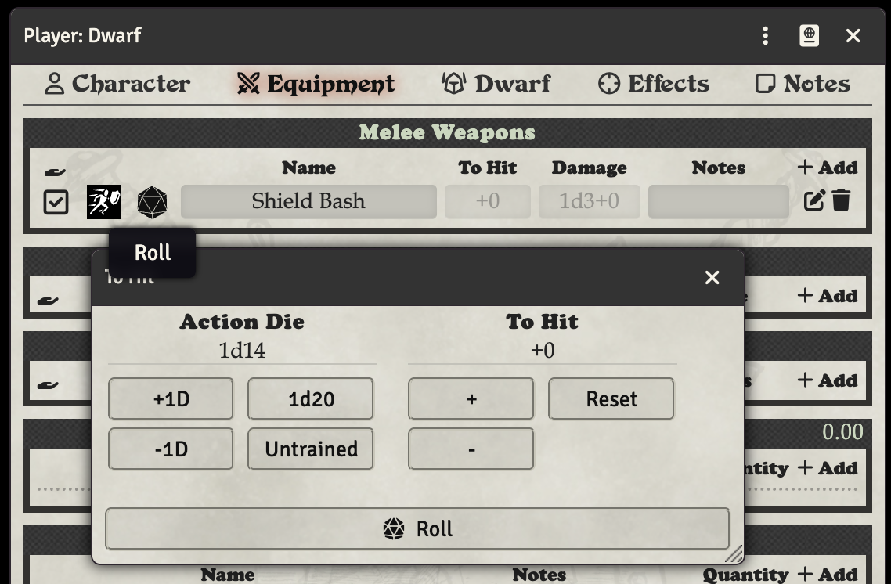
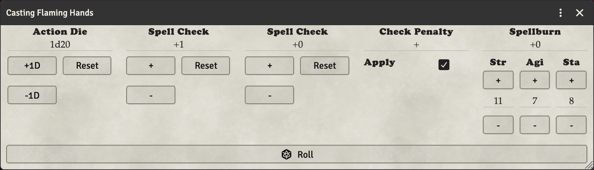

# Modifying Rolls or using Spellburn with Ctrl/Command Click

You can modify rolls on the fly by CTRL (PC) or Command (MAC) clicking a roll. This will allow you to modify many aspects of the roll. You can do this with any roll on the character sheet, and some rolls have their own options to modify.

You can even use Spellburn with spells, and they will reduce physical stats.

## Burning Luck

Attacks, saving throws, ability checks, skill checks and spell checks opened this way also show a **Luck Burn** term for player characters. Use its + and − buttons to choose how many points of Luck to burn; the field shows the bonus that buys and the box under it shows the Luck you will have left. The Luck is spent when you click Roll, and the roll card lists the bonus as its own Luck Burn modifier.

- Most characters get +1 per point burned.
- Halflings get +2 per point (good luck charm).
- Thieves roll their Luck Die once per point burned (the die is set on the Thief tab). The dice are rolled when you click Roll, and the attack card shows the total with the dice next to it, e.g. `+5[Luck Burn 2d3]`.

### Burning Luck after the roll

You can also decide after seeing the result. Right-click the attack, check, save, skill or spell check card in chat and choose **Burn Luck**. Pick the points in the same Luck Burn dialog; a new chat card shows the bonus and the roll's new total, e.g. "burns 2 Luck after the roll (Fortitude Save): +4, so the total goes from 13 to 17". The original card is not changed, so the judge decides whether the new total hits, saves or reaches a better spell result. The entry only appears on cards rolled by a character you own that has Luck left.

With the Ability Score Log enabled, each burn is logged as a Luck spend, so thieves and halflings can recover it from the log.
