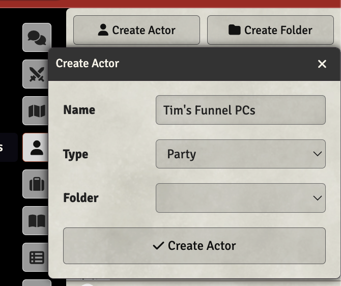
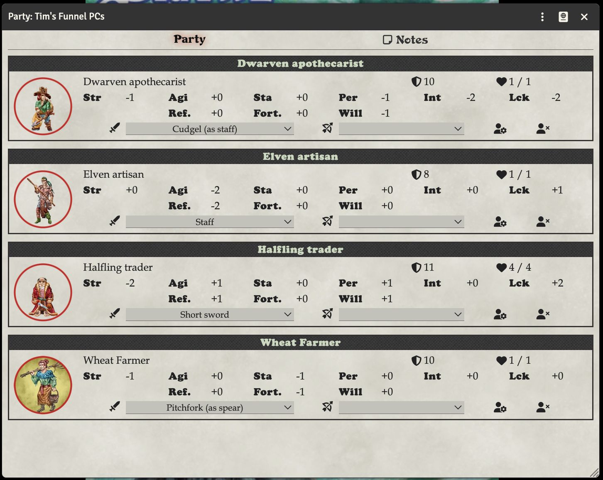
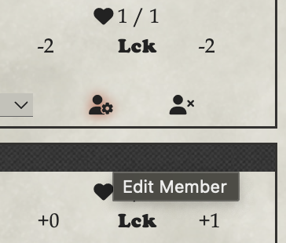
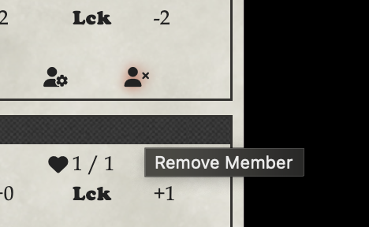
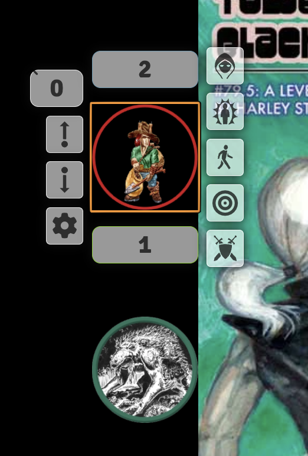

# Party Sheet

You can create an Actor of type "Party" to represent your party. This actor allows you to drag and drop other actors onto the Party Sheet, so you can move and manage them as one.

Useful for overland maps, or for funnels. A party could represent all the PCs controlled by a player in a funnel.

## Creating a Party Actor

## Adding Actors to the Party
You drag actors from the Actors tab onto the Party Sheet.

## Changing the Party Portrait
The party's own portrait appears next to its name at the top of the party sheet. Click it to choose a new image. This is separate from the party token's image, which you change with Configure Prototype Token in the sheet header.

## Editing Actors in the Party
You can click the avatar image of an actor on the party sheet to open their character sheet. Alternatively, there is a button that is a person with a gear in the lower right of each actor. Click that to open the regular actor sheet for that actor.

## Removing Actors from the Party
There is a button that is a person with an X in the lower right of each actor on the party sheet. Click that to remove the actor from the party.

## Giving Items to Party Members
Drag an item onto a member's row on the party sheet to add it to that character's inventory.

- From another character's sheet, or from a member's weapon icon on the party sheet, the item is **moved**: it is added to the target member and removed from the character it came from.
- From the Items sidebar or a compendium, the item is **copied**; the original stays where it was.

The Party actor has no inventory of its own. Dropping an item on an empty part of the party sheet, away from the member rows, shows a notice and leaves the item where it was. Drop it on a member row or on a character sheet instead.

## Rolling Party Initiative
The Initiative button (d20 icon) at the top of the party sheet rolls initiative for the party and adds the party token to the combat tracker. The roll uses the initiative formula of the party's best member — the one with the highest initiative bonus (ties broken by Agility) — including any initiative die changes from that member's equipped weapon (for example a two-handed weapon's d16).

The party token must be placed in the current scene before rolling; the party sheet will warn you if it isn't.

## Notes and Active Effects
The party sheet has a **Notes** tab for free-form text about the party. It has no Effects tab: a Party actor has no statistics of its own, and effects on it would never apply to its members. Dropping an Active Effect onto the party sheet shows a notice and does nothing; drop it on the member's own sheet instead. See [Active Effects](Active-Effects.md).

## Using the Party Actor on the map
You can drag the Party Actor onto the map, and it will create a token for the party. You can then move the token around the map to represent the position of the party.

By default, only the GM can move the party token. To let a player move it during travel, give them **Owner** permission on the Party actor in Actor Configuration → Permissions. With **Vision From All Owned Tokens** enabled and token vision turned on for the party token (Token Configuration → Vision tab), that also lets the player see through the party token.

You can then double-click this to see the party sheet. You can use the gear on the token on the map to set it's icon.

## Using individual tokens on the map
You can still drag individual actors onto the map, and they will create their own tokens. You can then move them around the map individually.

When a player runs several characters this way, the **Vision From All Owned Tokens** setting (on by default) keeps all of their characters visible and selectable even while one token is selected — see [System Settings](System-Settings.md).

You can use the topmost box when you right-click a token to edit their hp - you can type expressions like '-2' or '+2' to make incremental changes to their HP.

## Gathering and Deploying Party Tokens

The **Gather / Deploy** button in the party sheet header is for GMs only. Its label stays the same: click it to gather member tokens on the current scene, or to deploy members when they have already been gathered. The party token remains on the scene throughout; gathering shows it, and a deploy that places members hides it. If you manually show or hide the party token, that does not change what the button does next. When more than one GM is logged in, only the active GM performs the change: another GM's click shows "Request sent to the active GM", and the gather and deploy notices appear on the active GM's screen.

### Gather

Select the member tokens you want to gather, then click **Gather / Deploy**. With nothing selected, the GM gathers all eligible party member tokens on the scene. This also works if Foundry has left only the party token selected after you placed it. Selected tokens from other actors are left alone; selecting only those tokens does not gather the whole party.

The same control is on the token HUD: a party token's HUD gathers or deploys that party, while a member token's HUD offers **Gather** only when at least two eligible member tokens are selected (and asks which party if several match).

Only member tokens with **Link Actor Data** enabled can be gathered; unlinked tokens stay on the scene. To include one, enable **Link Actor Data** in its token configuration first. The party token moves to the center of the gathered members and becomes visible, ready to move as a group.

### Deploy

After gathering, move the party token where you want the members to appear and click **Gather / Deploy**. Their tokens reappear around it with their gathered token details, such as size, vision, and light. They are placed around the party token at its **current** location, not at their former map coordinates. The party token stays on the scene but is hidden. Members who were removed from the party or whose actor was deleted before the deploy are skipped and not restored; their saved token data is discarded once the deploy succeeds.

If a member's token already stands on the destination scene, saved tokens cannot be restored until the GM moves that token to another scene or removes it.

If you have not gathered anyone and place a party token on a scene that has no member tokens, clicking **Gather / Deploy** instead creates member tokens around it from each member's prototype token settings. This does **not** restore placements or token changes from an earlier scene. Members who already have tokens on this scene are not duplicated. When member tokens are already present, the click is a gather instead: tokens in started combat produce the skipped-combat notice, unlinked tokens produce the no-eligible-members notice, and neither creates prototype tokens. If there is nothing to create at all, the party token stays visible and a notice says there is nothing to deploy. If a member who needs a token has **Link Actor Data** disabled on their prototype token, no new member tokens are created; enable it there before trying again. If there is neither a party token nor member tokens on the scene, you get a notice instead.

### Travel between scenes

Gather the members on the first scene, then place a party token for the same Party actor on the destination scene with **Link Actor Data** enabled. Click **Gather / Deploy** there to place the gathered members around that party token. The party token on the first scene is left alone. For a fresh party token without a prior gather, the members instead appear from their prototype settings, as described above.

### Practical caveats

- Use a party token with **Link Actor Data** enabled. If an older party token is unlinked, enable **Link Actor Data** in that token's configuration before trying again; the action will not replace it for you. To gather without a party token already on the scene, enable **Link Actor Data** in the Party actor's prototype token configuration first.
- You cannot gather again until you have deployed the gathered members. Member tokens in any started combat on the scene are skipped during gathering, even when that combat is not linked to the scene. If the party token is in a running combat, end that combat before gathering or deploying.
- Gather tokens on the level you are viewing. If a member token being gathered or the party token is on a different level, gathering stops without moving them. Deployment places members on the party token's level.
- Deployment keeps each member's saved elevation when it stays on the same level; on a different level it places them at that level's base elevation. The party token's own elevation does not affect where members appear.
- If an action warns that it failed partway, check the party token and member tokens on the affected scenes. If the rollback could not be confirmed, gather and deploy for that party are blocked: repair the tokens and the saved snapshot first. Reloading clears the block, but it does not repair the documents.

## The party token's health bar

The party token's health bar shows the combined current and maximum hit points of the party's member Actors. It updates when a member Actor's HP changes or when you add or remove members. The bar is read-only: change a member's HP on their own sheet. HP stored on an unlinked member token is not included; link that token or edit the Actor instead.

Existing Party actors and party tokens already placed on a scene get the combined HP bar automatically when the world migrates on the next system update. A Bar 1 attribute the GM configured themselves (anything other than the system default) is left untouched.
